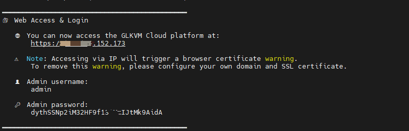
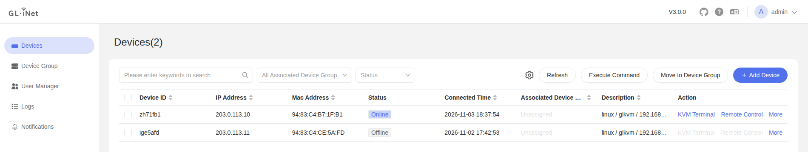
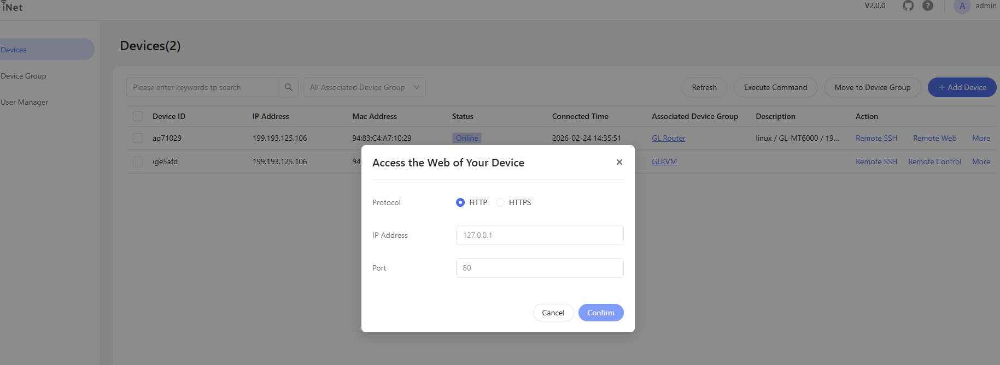

# Self-Deployed Lightweight Cloud KVM Remote Management Platform

[中文文档](./README.zh-CN.md) | English

Self-Deployed Lightweight Cloud is a lightweight KVM remote cloud platform tailored for individuals and small businesses. This project is developed based on [rttys](https://github.com/zhaojh329/rttys), designed for users who need to **quickly** build a remote access platform while prioritizing **data security**. 

#### Main Functions and Features

-  **User Groups and Device Support** - Supports user groups managing specific device groups, enabling different users to manage different devices
-  **Access Code Onboarding** - Add a KVM by pasting an access code into its local web UI; the device proves itself with its factory certificate
-  **Remote SSH** - Web SSH remote connections
-  **Remote Control** - Web remote desktop control
-  **Batch Operations** - Batch command execution capabilities
-  **Rapid Deployment** - Quick self-deployment with simple operations
-  **Data Security** - Private deployment with full data control
-  **Dedicated Bandwidth** - Exclusive bandwidth for self-hosted deployments 
-  **Lightweight Design** - Optimized for small businesses and individual users
-  **Enterprise Authentication** -  Supports both **LDAP** and **OIDC** login methods for enterprise users. 

-  **Deployment & Platform Compatibility** - Supports both **internal network** and **public internet** deployments on **x86_64** and **arm64** platforms
-  **HTTP/HTTPS Web Proxy Support** - Reach web services on the KVM, or on hosts it can reach, through the cloud

## Self-Hosting Guide

The following mainstream operating systems have been tested and verified

#### Debian Family

- Ubuntu 18.04 / 20.04 / 22.04 / 24.04
- Debian 11 / 12

#### Red Hat Family

- AlmaLinux 8 / 9
- Rocky Linux 8 / 9
- CentOS Stream 9

#### Requirements

|      Component      | Minimum Requirement |
| :-----------------: | :-----------------: |
|         CPU         |  1 core or above   |
|       Memory        |       ≥ 1 GB        |
|       Storage       |       ≥ 40 GB       |
| Network Bandwidth   | ≥ 3 Mbps      |
| KVM Device Firmware |      ≥ v1.5.0       |

#### Cloud Security Group Settings

If your server provider uses a **cloud security group** (e.g., AWS, Aliyun, etc.), please make sure the following ports are **open**:

| Port  | Protocol | Purpose                        |
| ----- | -------- | ------------------------------ |
| 443   | TCP      | Web UI access                  |
| 10443 | TCP      | WebSocket proxy                |
| 5912  | TCP      | Device connection for devices still on old firmware (deprecated, see below) |
| 5915  | TCP      | Device connection (new firmware, access code) |
| 3478  | TCP/UDP  | TURN server for WebRTC support |

⚠️ **Important:**
 These ports will be **used by GLKVM Cloud**. Please ensure **no other applications or services** on your server are binding to these ports, otherwise the lightweight cloud platform may fail to start properly.

------
### Installation

We provide **two** ways to install GLKVM Cloud: 

#### A) One-line installer (recommended, x86_64/amd64)

> **Note:** The one-line installer is **Docker-based**. It automates Docker/Compose setup, pulls images, renders configs from templates, and starts services for you.
>
> **Platform:** currently supports **x86_64 (amd64)** only.

Run **as root**:

```bash
( command -v curl >/dev/null 2>&1 && curl -fsSL https://kvm-cloud.gl-inet.com/selfhost/install.sh || wget -qO- https://kvm-cloud.gl-inet.com/selfhost/install.sh ) | sudo bash
```

#### B) Docker manual install

> Full reference: see [`docker-compose/README.md`](https://github.com/gl-inet/glkvm-cloud/blob/main/docker-compose/README.md)
>
> **Platform:** supports both **x86_64 (amd64)** and **arm64 (AArch64)**. 

### Platform Access

Once the installation is complete, the installer will print the platform URL and admin login credentials in the console. You can access the platform via:

```
https://<your_server_public_ip>
```

⚠️ **Note**: Accessing via an IP address will trigger a **browser certificate warning**.
To remove the warning, configure your own domain and a valid SSL certificate.

### Web UI Login Credentials

At the end of the installation script, the console will display the Web UI administrator username and password (for example):

```text
👤 Admin username: admin
🔑 Admin password: <auto-generated-password>
```



## Feature Demonstrations

###  Add KVM Devices to the Lightweight Cloud 

The device needs firmware with self-hosted cloud access.

- In the cloud, open **Add Device**, generate an access code and copy it. Each code works once, on any device, within 24 hours.
- On the device's local web UI, open the self-hosted cloud page and paste the access code. The device verifies the cloud with the CA in the code, and the cloud verifies the device with its factory certificate.
- Devices connected to the cloud




### Devices on Old Firmware

Devices that were added with the old script keep connecting on port 5912 after the cloud is upgraded. Old firmware cannot be added anymore. To move a device to access codes:

1. Upgrade the cloud first, then the device firmware.
2. Paste an access code into the device's self-hosted cloud page. The device keeps its record, ID and groups in the cloud; if it is still connected the old way, it switches over without going offline.

Port 5912 is deprecated and will be removed in a later release. Once no device uses it, set `RTTYS_LEGACY_TOKEN_ACCESS=false` to close it.

### Remote SSH Connection


### Remote Desktop Control


### Web Proxy




##  Use your own SSL Certificate (Optional) 

⚠️ **Note**:

If you just want to **quickly try out GLKVM Cloud** and don’t mind the browser’s certificate warning,
you can **skip** configuring a custom domain and SSL certificate, and still access the platform via the server’s **public IP** with HTTPS.

For production use, or if you need to **access multiple KVM devices via subdomains**, it is **strongly recommended** to configure your own **wildcard SSL certificate** (see below).

#### Add DNS Records

To enable full domain-based access, configure the following DNS records for your domain:

```
┌────────────┬──────┬────────────────────┬─────────────────────────────┐
│ Hostname   │ Type │     Value           │         Purpose             │
├────────────┼──────┼────────────────────┼─────────────────────────────┤
│ www        │  A   │ Your public IP      │ Web access to the platform │
│ *          │  A   │ Your public IP      │ Remote access to KVMs      │
└────────────┴──────┴────────────────────┴─────────────────────────────┘
```

#### Using a Custom SSL Certificate

No certificate is shipped: if you provide none, GLKVM Cloud generates a self-signed one on first start.
To avoid browser warnings, put your own **wildcard SSL certificate** in place
 that supports both:

- `*.your-domain.com` (for device access)
- `www.your-domain.com` (for platform access)

Put them in:

```
~/glkvm_cloud/certificate
```

- `glkvm.cer`
- `glkvm.key`

⚠️ **Make sure the filenames remain unchanged.**

The device ports don't use this certificate. They use one signed by the platform's own CA,
generated in `~/glkvm_cloud/database/pki`. Keep that directory and include it in your backups:
devices that joined with an access code trust that CA and lose access if it is replaced.

#### Restart Services After Configuration Changes

After replacing certificates, restart the GLKVM Cloud services to apply the changes:

```bash
cd ~/glkvm_cloud
docker-compose down && docker-compose up -d
```

Or, on systems with the Docker CLI plugin:

```bash
docker compose down && docker compose up -d
```

### Domain-Based Access Example

Once everything is configured, you can access the platform via your domain:

```
https://www.your-domain.com
```
