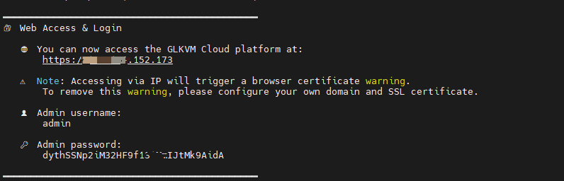
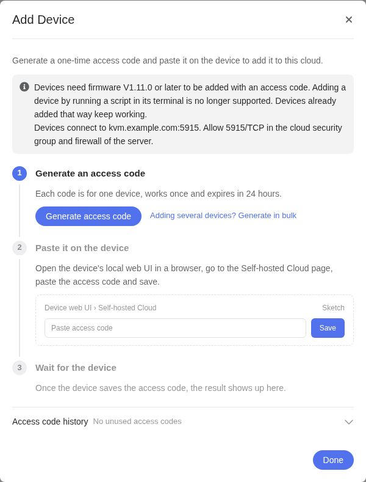
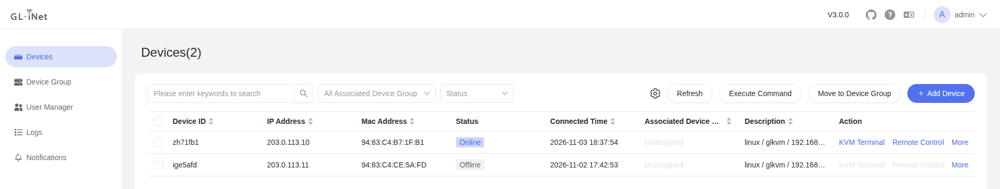

# 自部署轻量云 KVM 远程管理平台

[English Documentation](./README.md) | 中文

自部署轻量云（GLKVM Cloud）是一款面向个人和小微企业的轻量级 KVM 远程管理平台。
本项目基于 [rttys](https://github.com/zhaojh329/rttys) 开发，专为需要**快速**搭建自己的远程访问平台、并注重**数据安全**的用户设计。

#### 主要功能与特性

*  **用户组和设备组** - 为用户组分配设备组，让不同用户管理不同设备
*  **接入码接入** - 在设备本地网页粘贴接入码即可添加设备，设备凭出厂证书证明身份
*  **KVM 终端** - 在网页上登录 KVM 设备本身的终端
*  **远程控制** - 在浏览器里远程控制 KVM 的桌面
*  **批量操作** - 一次对多台设备执行命令
*  **快速部署** - 一条命令即可完成部署
*  **数据安全** - 私有化部署，数据完全可控
*  **独享带宽** - 使用自己服务器的带宽，不与他人共享
*  **轻量设计** - 专为小型企业和个人优化
*  **企业级认证** - 支持 **LDAP** 和 **OIDC** 登录
*  **部署与平台兼容性** - 支持**内网部署**和**公网部署**，兼容 **x86_64** 与 **arm64** 平台

## 自部署指南

以下操作系统已通过测试：

#### Debian 系列

* Ubuntu 18.04 / 20.04 / 22.04 / 24.04
* Debian 11 / 12

#### Red Hat 系列

* AlmaLinux 8 / 9
* Rocky Linux 8 / 9
* CentOS Stream 9

#### 系统要求

|     组件     | 最低配置要求 |
| :----------: | :----------: |
|     CPU      |  1 核及以上  |
|     内存     |    ≥ 1 GB    |
|     存储     |   ≥ 40 GB    |
|   网络带宽   |   ≥ 3 Mbps   |
| KVM 固件版本 |  ≥ v1.11.0   |

#### 云安全组端口要求

如果你的服务器提供商（如 AWS、阿里云等）启用了**云安全组**，请确保以下端口已开放：

| 端口  | 协议    | 用途                                   |
| ----- | ------- | -------------------------------------- |
| 443   | TCP     | 平台 Web 界面                          |
| 10443 | TCP     | 设备远程访问（远程控制）               |
| 5912  | TCP     | 用旧脚本接入的设备（已弃用，见[旧固件设备](#旧固件设备)） |
| 5915  | TCP     | 用接入码接入的设备                     |
| 3478  | TCP/UDP | WebRTC TURN 中继                       |

**注意**：这些端口由 GLKVM 轻量云使用，请确保服务器上没有其他程序占用，否则平台可能无法正常启动。

## 安装

我们提供**两种**安装方式：

#### A) 一键安装脚本（推荐，仅支持 x86_64 / amd64）

> **注意：** 一键安装脚本基于 **Docker**，会自动安装 Docker / Docker Compose、拉取镜像、根据模板生成配置文件并启动所有服务。
>
> **平台支持：** 当前仅支持 **x86_64（amd64）** 平台。

使用 **root 权限**运行：

```bash
( command -v curl >/dev/null 2>&1 && curl -fsSL https://kvm-cloud.gl-inet.com/selfhost/install.sh || wget -qO- https://kvm-cloud.gl-inet.com/selfhost/install.sh ) | sudo bash
```

#### B) 使用 Docker 手动安装

> 完整参考文档请查看：[`docker-compose/README-CN.md`](https://github.com/gl-inet/glkvm-cloud/blob/main/docker-compose/README-CN.md)
>
> **平台支持：** 同时支持 x86_64（amd64）与 arm64（AArch64）平台。

### 平台访问

安装完成后，安装脚本会在控制台输出平台访问地址和管理员登录信息。通过以下地址访问平台：

```
https://<你的服务器公网IP>
```

通过 IP 访问时，浏览器会提示证书不受信任。如需消除该提示，请使用自己的域名和证书，见[使用自有域名和 SSL 证书](#使用自有域名和-ssl-证书可选)。

### Web 界面登录信息

安装结束时，控制台会显示 Web 界面的管理员用户名和密码，例如：

```text
   👤 Admin username:
       admin

   🔑 Admin password:
       <自动生成的密码>
```



### 升级

升级时部署文件和镜像要一起更新。只改镜像版本号不够：v3.0 之前的 `docker-compose.yml` 没有对外开放 5915 端口，设备无法用接入码接入（添加设备弹窗会给出提示）。

**用一键安装脚本安装的：** 先备份 `~/glkvm_cloud/database`（例如 `cp -a ~/glkvm_cloud/database ~/glkvm_cloud-database-backup`），然后用 root 在原来的目录（`glkvm_cloud` 所在的目录）重新运行安装脚本。脚本会下载新镜像和部署文件，保留 `.env` 和数据库，并重启服务。最后在云安全组放行 5915/TCP。

**手动安装的：**

1. 按上面的方法备份 `~/glkvm_cloud/database`。里面有数据库和 `pki`，用接入码接入的设备信任的 CA 就在 `pki` 里。
2. 把新的部署文件放进 `~/glkvm_cloud`。部署包里没有 `.env` 和数据库，两者都会保留：

   ```bash
   cd ~/glkvm_cloud
   curl -fsSLO https://kvm-cloud.gl-inet.com/selfhost/docker-compose.tar.gz
   tar -xzf docker-compose.tar.gz
   ```

   也可以从本仓库的 `docker-compose` 目录复制 `docker-compose.yml`、`templates` 和 `scripts`。
3. 检查 `.env`。从 v3.0 起 `RTTYS_PASS`、`RTTYS_TOKEN`、`TURN_USER`、`TURN_PASS` 没有默认值，任一项为空时平台或 coturn 不会启动。旧固件设备会继续使用当初拿到的 token 和 TURN 账号：如果之前这几项留空，它们用的是 `DeviceTokenYouCanChangeMe` 和 `glkvmcloudwebrtcuser` / `AnotherS3cret`，要让这些设备在迁移到接入码之前继续可用，就填这几个值。
4. 在云安全组和防火墙放行 5915/TCP。
5. 获取新镜像并重启：

   ```bash
   docker-compose pull    # 或：curl -fsSLO https://kvm-cloud.gl-inet.com/selfhost/glkvmcloud.tar && docker load -i glkvmcloud.tar
   docker-compose down && docker-compose up -d
   ```

   使用 Docker CLI 插件时，把 `docker-compose` 换成 `docker compose`。

## 功能演示

#### 添加 KVM 设备

设备固件需要 v1.11.0 或更高版本。

1. 在平台上打开「添加设备」，生成接入码并复制。每个接入码 24 小时内有效，只能使用一次，不限定设备。

   

2. 在设备本地网页进入「自部署云」页面，粘贴接入码并保存。设备用接入码里的 CA 校验平台，平台用设备的出厂证书校验设备。如果设备已接入其他自部署平台，要先在这个页面断开。
3. 设备接入成功后，会出现在设备列表里：

   

#### 旧固件设备

用旧脚本接入的设备，在平台升级后继续通过 5912 端口连接。低于 v1.11.0 的固件已不能再新接入，在设备终端执行脚本的接入方式也不再支持。迁移到接入码的步骤：

1. 先升级平台，再把设备固件升级到 v1.11.0 或更高版本。
2. 在设备的「自部署云」页面粘贴接入码。设备在平台上的记录、ID 和分组都会保留；如果设备仍以旧方式在线，切换过程中不会掉线。

5912 端口已弃用，后续版本会移除。没有设备再使用后，可设置 `RTTYS_LEGACY_TOKEN_ACCESS=false` 关闭。

#### KVM 终端


#### 远程控制


## 使用自有域名和 SSL 证书（可选）

如果只是想快速体验 GLKVM 轻量云，并且不介意浏览器的证书警告，可以跳过本节，继续用服务器公网 IP 访问平台。

生产环境建议用自己的域名和有效证书访问平台。设备会通过子域名打开，例如 `https://<设备ID>.your-domain.com:10443`，因此需要泛域名解析和泛域名证书，配置方法见下文。如果平台前面有 Nginx，也可以改为按路径在平台域名下打开设备，只需要一张单域名证书，见[按路径访问设备](docker-compose/README-CN.md#按路径访问设备可选)。

#### 添加 DNS 记录

| 主机记录 | 类型 | 值               | 用途           |
| -------- | ---- | ---------------- | -------------- |
| `www`    | A    | 你的服务器公网 IP | 平台 Web 界面  |
| `*`      | A    | 你的服务器公网 IP | 设备远程访问   |

平台要用 `www` 这样的子域名访问：设备地址是把平台域名的第一段换成设备 ID，例如 `www.your-domain.com` 对应 `<设备ID>.your-domain.com`。

#### 使用自定义 SSL 证书

申请一张 `*.your-domain.com` 的泛域名证书，它同时覆盖 `www.your-domain.com` 和各设备的子域名。把证书（完整证书链）和私钥放到 `~/glkvm_cloud/certificate`，文件名必须是：

* `glkvm.cer`
* `glkvm.key`

没有放证书时，GLKVM 轻量云会在首次启动时自动生成一张证书，浏览器会提示不受信任。

设备接入端口不使用这张证书，而是使用平台自有 CA 签发的证书，生成在 `~/glkvm_cloud/database/pki`。
请保留该目录并纳入备份：通过接入码接入的设备信任这个 CA，CA 被替换后设备将无法接入。

#### 接入码使用域名（可选）

接入码默认让设备连接 `GLKVM_ACCESS_IP`。如果希望设备通过域名连接，服务器 IP 变了也不受影响，在 `~/glkvm_cloud/.env` 中设置：

```env
DEVICE_ACCESS_HOST=www.your-domain.com
```

重启后新生成的接入码才会使用域名，已经接入的设备不受影响。

#### 重启服务

修改证书或 `.env` 后，需要重启 GLKVM 轻量云服务才能生效：

```bash
cd ~/glkvm_cloud
docker-compose down && docker-compose up -d
```

或（Docker CLI 插件版本）：

```bash
docker compose down && docker compose up -d
```

之后即可通过 `https://www.your-domain.com` 访问平台。
